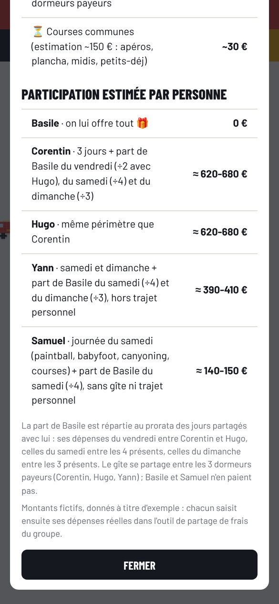

# Roadbook de week-end entre amis

Un modèle de page web pour organiser un week-end à plusieurs : programme étape par étape, météo, liste des choses à faire, budget par personne, infos pratiques et dépôt de photos souvenirs.

La page est **optimisée pour le smartphone** : elle est faite pour être consultée pendant le week-end, sur la route et entre deux activités.

**Tout le contenu se règle dans un seul fichier, `donnees.js`**, sans toucher au code. Il n'y a rien à installer, et la page s'héberge gratuitement.

**[Voir la démonstration en ligne](https://famickael.github.io/roadbook-evg/)**

> **In English.** A reusable template for a weekend trip roadbook: day-by-day schedule, weather, to-do list, budget per person, practical info and photo keepsakes. It is a static page with no build step, and all content lives in a single file, `donnees.js`. The page, the sample data and the documentation are in French.

<table>
  <tr>
    <td></td>
    <td></td>
    <td></td>
    <td></td>
  </tr>
</table>

L'exemple fourni est un enterrement de vie de garçon de 3 jours, sur le thème des pompiers : un pompier en pixel art anime l'en-tête et un camion de pompier suit la progression du programme. **Toutes les données sont fictives** : prénoms, communes, adresses, prestataires, téléphones et montants ont été inventés, et les images sont des illustrations générées.

## Fonctions

| Fonction | Description |
|---|---|
| Programme | Une frise par jour, avec l'heure, la durée, le temps de trajet et un bouton d'itinéraire pour chaque étape |
| Navigation | Barre des jours toujours visible, et un camion qui suit l'heure du programme pendant le week-end |
| Météo | Prévisions avant le week-end, puis relevés réels une fois la date passée |
| Fiches pratiques | Une fenêtre par lieu et par repas : adresse, horaires, téléphone, menu, liste de courses |
| À faire | Liste des réservations à cocher, classées par urgence |
| Budget | Coût par poste et participation estimée de chaque personne |
| Souvenirs | Dépôt de photos et de vidéos sur chaque étape, galerie et téléchargement en un fichier zip |
| Version souvenir | Un réglage masque l'organisation après le week-end, pour offrir la page comme album |
| Bandeau secret | Rappel de ne pas partager la page avec l'invité d'honneur, masqué après le week-end |

## Démarrer

1. **Copiez le dépôt** avec le bouton « Use this template » ou « Fork », ou téléchargez le zip.
2. **Ouvrez `donnees.js`** dans un éditeur de texte et remplacez le contenu fictif par le vôtre.
3. **Vérifiez le résultat** en ouvrant `index.html` dans un navigateur. Un double-clic suffit.
4. **Publiez** : dans les réglages du dépôt, rubrique « Pages », choisissez « Deploy from a branch », puis la branche `main` et le dossier `/ (root)`. Le site est ensuite mis en ligne à chaque modification.

Une étape du programme s'écrit ainsi dans `donnees.js` :

```js
{
  id: "karting",
  heure: "09:45",
  duree: "1h30 de piste",
  titre: "Karting du circuit de Brumeval",
  texte: "Arrivée 15 min avant l'ouverture.",
  reserve: "10h00",
  itineraire: "Circuit de Brumeval"
},
{ trajet: "🚗 ~45 min" }
```

Toutes les rubriques et tous les champs sont décrits dans [la référence de `donnees.js`](docs/donnees.md).

## Contenu du dépôt

| Fichier | Rôle | À modifier ? |
|---|---|---|
| `donnees.js` | Tout le contenu : titres, jours, étapes, fenêtres, liste à faire, budget, infos, photos de démonstration | Oui |
| `photos/` | Images affichées d'office dans la galerie | Oui, ou à vider |
| `index.html` | Structure, styles et script de la page | Seulement pour changer l'apparence ou le fonctionnement |
| `.nojekyll` | Fichier vide qui demande à GitHub Pages de publier les fichiers tels quels | Non |
| `exemples/` | Exemple de stockage partagé des photos avec Supabase | Seulement pour partager les photos |
| `docs/` | Documentation et captures d'écran | Non |

## Photos et vie privée

Les photos et vidéos déposées **restent dans le navigateur de la personne qui les dépose**. Rien n'est envoyé sur un serveur : la page fonctionne sans compte, sans clé et sans hébergement payant. En contrepartie, chaque visiteur ne voit que ses propres dépôts. Pour partager les photos entre participants, un [exemple de stockage partagé](docs/souvenirs.md) est fourni.

Avant d'utiliser le modèle pour un vrai week-end, 3 points sont à connaître :

- Une page GitHub Pages est accessible à toute personne qui en connaît l'adresse, et un dépôt public conserve l'historique de toutes ses versions. Pour de vraies données personnelles, un dépôt privé ou un hébergement à accès restreint est préférable.
- Le stockage du navigateur ne constitue pas une sauvegarde. Le bouton « Tout télécharger » permet de récupérer les souvenirs dans un fichier zip.
- La page contacte Google Fonts et Open-Meteo à chaque ouverture, et cdnjs lors du téléchargement en zip.

## Documentation

| Page | Contenu |
|---|---|
| [Référence de `donnees.js`](docs/donnees.md) | Les rubriques du fichier, les champs d'une étape, les repères utiles |
| [Personnaliser le roadbook](docs/personnaliser.md) | Le camion de progression, la météo, le thème et ses dessins, la version souvenir |
| [Dépôt de photos](docs/souvenirs.md) | Le stockage dans le navigateur, et le partage entre participants avec l'exemple Supabase |
| [Précautions d'usage et limites](docs/precautions.md) | Données personnelles, services externes, stockage partagé, limites connues du code |
| [Étude de cas](docs/etude-de-cas.md) | Le besoin, les publics, les choix de conception, les pistes d'évolution, les 8 écrans |

## Tester en local

Un double-clic sur `index.html` suffit pour consulter la page. Les boutons de téléchargement de la galerie demandent en revanche un petit serveur local :

```bash
python3 -m http.server 8000
```

La page est alors disponible à l'adresse `http://localhost:8000`.

## Contribuer

Les suggestions et les signalements de problèmes sont les bienvenus dans les [issues](../../issues) du dépôt.

## Origine et licence

Cette page a été conçue et écrite avec Claude, l'assistant d'Anthropic. La question de savoir si un contenu produit avec une intelligence artificielle peut être protégé par le droit d'auteur reste discutée. Plutôt que de revendiquer des droits incertains, le choix a été fait de verser l'ensemble au domaine public.

Le contenu de ce dépôt est donc placé sous licence [Creative Commons Zero 1.0](LICENSE). Il peut être copié, modifié et réutilisé librement, sans autorisation ni mention obligatoire.
