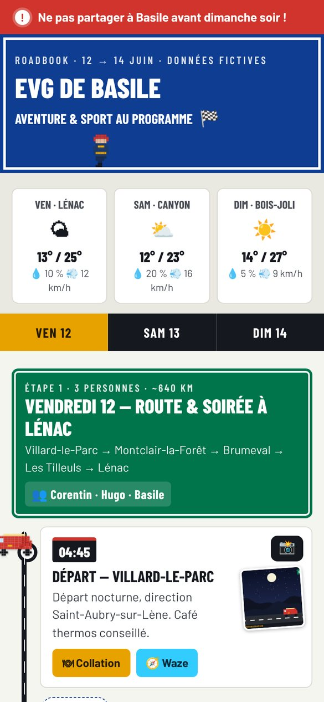
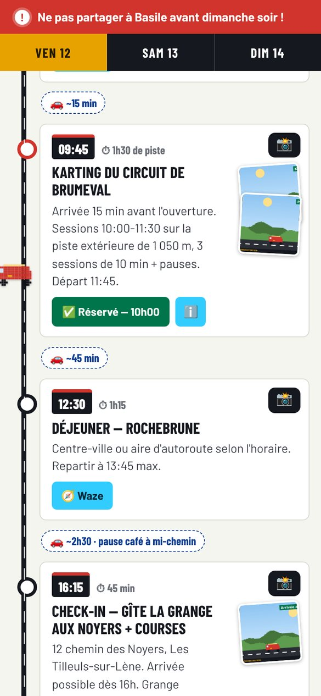
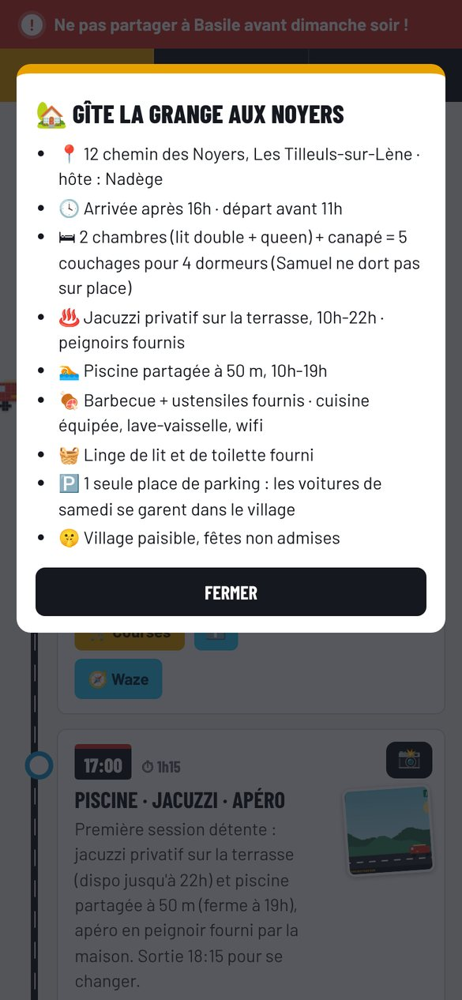
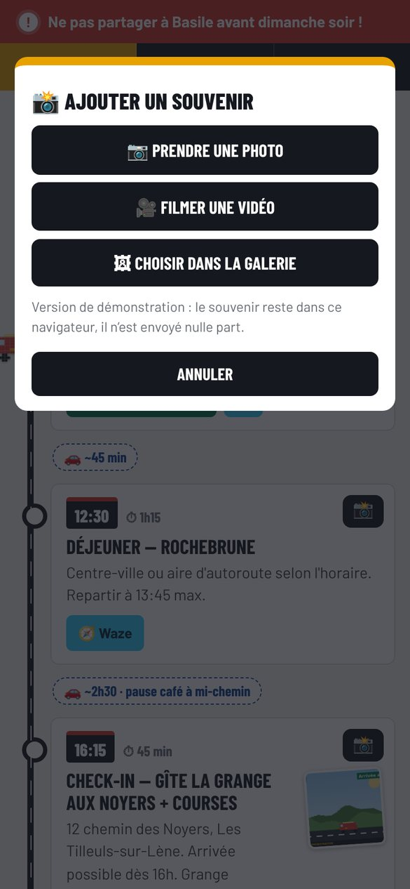
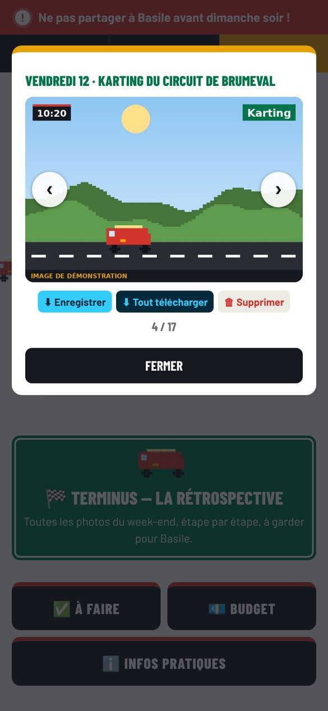
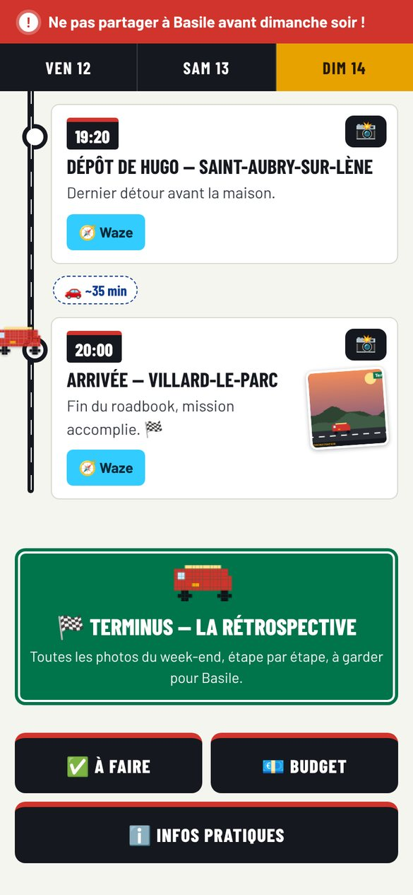
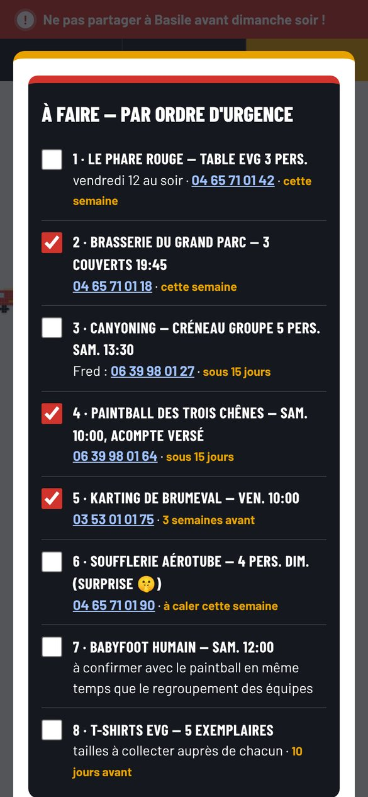

# Roadbook de week-end entre amis

Un modèle de page web pour organiser un week-end à plusieurs : programme étape par étape, météo, liste des choses à faire, budget par personne, infos pratiques sur les lieux et dépôt de photos souvenirs.

Le modèle est prêt à être réutilisé. **Tout le contenu se règle dans un seul fichier, `donnees.js`**, sans toucher au code. Il n'y a rien à installer ni à compiler, et la page s'héberge gratuitement.

L'exemple fourni est un enterrement de vie de garçon de 3 jours. **Toutes les données sont fictives** : les prénoms, les communes, les adresses, les prestataires et les montants ont été inventés. Les numéros de téléphone sont pris dans les tranches réservées aux œuvres de fiction, et les images sont des illustrations générées, sans personne réelle.

Cette page a été conçue avec Claude, l'assistant d'Anthropic. C'est la raison pour laquelle elle est placée dans le domaine public (voir la rubrique « Origine et licence »).

## Aperçu

<table>
  <tr>
    <td></td>
    <td></td>
    <td></td>
    <td></td>
  </tr>
  <tr>
    <td align="center">Programme et météo</td>
    <td align="center">Étapes et trajets</td>
    <td align="center">Fiche d'un lieu</td>
    <td align="center">Dépôt d'un souvenir</td>
  </tr>
  <tr>
    <td></td>
    <td></td>
    <td></td>
    <td></td>
  </tr>
  <tr>
    <td align="center">Galerie</td>
    <td align="center">Accès rapide</td>
    <td align="center">Liste « À faire »</td>
    <td align="center">Budget par personne</td>
  </tr>
</table>

Captures réalisées sur un écran de téléphone, avec les données fictives du modèle.

## Ce que fait la page

| Fonction | Description |
|---|---|
| Programme | Une frise par jour, avec l'heure, la durée, le temps de trajet et un bouton d'itinéraire pour chaque étape |
| Navigation | Barre des jours toujours visible, et un camion qui suit la lecture le long de la frise |
| Météo | Prévisions avant le week-end, puis relevés réels une fois la date passée |
| Fiches pratiques | Une fenêtre par lieu (adresse, horaires, téléphone, consignes) et par repas (menu, liste de courses) |
| À faire | Liste des réservations à cocher, classées par urgence |
| Budget | Coût par poste et participation estimée de chaque personne |
| Souvenirs | Dépôt de photos et de vidéos sur chaque étape, galerie, rétrospective et téléchargement en un fichier zip |
| Bandeau secret | Rappel de ne pas partager la page avec l'invité d'honneur, masqué automatiquement après le week-end |

## Réutiliser le modèle

1. **Copiez le dépôt** : bouton « Fork » de GitHub, ou téléchargement du zip.
2. **Ouvrez `donnees.js`** dans un éditeur de texte et remplacez le contenu fictif par le vôtre.
3. **Vérifiez le résultat** en ouvrant `index.html` dans un navigateur. Un double-clic suffit.
4. **Publiez** : dans les réglages du dépôt, rubrique « Pages », choisissez « GitHub Actions » comme source. Le fichier `.github/workflows/pages.yml` met ensuite le site en ligne à chaque modification de la branche `main`.

### Contenu du dépôt

| Fichier | Rôle | À modifier ? |
|---|---|---|
| `donnees.js` | Tout le contenu : titres, jours, étapes, fenêtres, liste à faire, budget, infos, photos de démonstration | Oui |
| `photos/` | Images affichées d'office dans la galerie | Oui, ou à vider |
| `index.html` | Structure, styles et script de la page | Seulement pour changer l'apparence ou le fonctionnement |
| `.github/workflows/pages.yml` | Mise en ligne automatique avec GitHub Pages | Non |
| `docs/captures/` | Captures d'écran de ce README | Non |

### Le fichier `donnees.js`

Le fichier décrit un objet unique. Ses rubriques correspondent aux zones de la page.

| Rubrique | Ce qu'elle règle |
|---|---|
| `titre`, `surtitre`, `accroche` | L'en-tête bleu |
| `bandeau`, `finBandeau` | Le texte du bandeau rouge et la date à partir de laquelle il disparaît |
| `fuseau` | Le décalage horaire du lieu du week-end, par exemple `"+02:00"` en été en France |
| `lienDepenses` | L'adresse d'un outil de partage de frais. Vide, le bouton est masqué |
| `jours` | Les journées, avec leur onglet, leur date, le lieu de la météo et leur programme |
| `fenetres` | Les fenêtres ouvertes par les boutons : menus, listes de courses, fiches pratiques |
| `aFaire` | La liste des réservations et tâches à cocher |
| `budget` | Les postes de dépense, la participation par personne et les notes |
| `infos`, `telephones` | La fenêtre « Infos pratiques » et ses raccourcis d'appel |
| `photos` | Les images de démonstration et l'étape à laquelle chacune est rattachée |

Une étape du programme s'écrit ainsi :

```js
{
  id: "karting",                      // identifiant unique, sans espace ni accent
  heure: "09:45",
  duree: "1h30 de piste",             // facultatif
  type: "cle",                        // facultatif : "cle" (pastille rouge) ou "detente" (pastille bleue)
  titre: "Karting du circuit de Brumeval",
  texte: "Arrivée 15 min avant l'ouverture.",
  alerte: "Chaussures fermées obligatoires",   // facultatif : consigne mise en avant
  reserve: "10h00",                   // facultatif : affiche la pastille « Réservé »
  fenetres: [{ id: "collation", label: "🍽 Collation" }],  // facultatif : boutons vers une fenêtre
  fiche: "karting",                   // facultatif : bouton vers la fiche pratique du lieu
  itineraire: "Circuit de Brumeval"   // facultatif : bouton d'itinéraire
},
{ trajet: "🚗 ~45 min" }              // un temps de route entre deux étapes
```

Quelques repères utiles :

- Les identifiants cités dans `fenetres` et `fiche` renvoient aux entrées de la rubrique `fenetres` du fichier.
- Les photos sont rattachées à l'identifiant de leur étape. Une étape peut donc être ajoutée, retirée ou déplacée sans décaler les photos des autres. En revanche, l'identifiant d'une étape ne doit plus changer une fois que des photos y ont été déposées.
- Les textes acceptent du HTML simple, par exemple `<b>` ou un lien. Ils sont insérés tels quels dans la page : n'y collez que votre propre contenu.
- La météo vient de l'API ouverte [Open-Meteo](https://open-meteo.com/), sans clé. Il suffit d'indiquer la latitude et la longitude du lieu de chaque journée.
- Pour démarrer avec une galerie vide, remplacez la rubrique `photos` par `[]` et supprimez les images du dossier `photos/`.
- Les couleurs se règlent dans les variables CSS du bloc `:root`, en tête de `index.html`.

## Comment fonctionne le dépôt de photos

Dans ce modèle, **les photos et vidéos déposées restent dans le navigateur de la personne qui les dépose**. Rien n'est envoyé sur un serveur. La page ne nécessite donc aucun compte, aucune clé et aucun hébergement payant.

Concrètement :

- Le bouton appareil photo de chaque étape propose de prendre une photo, de filmer ou de choisir un fichier.
- Les photos sont réduites à 900 pixels de côté et compressées avant d'être enregistrées. La date de prise de vue est lue dans le fichier pour classer les souvenirs dans l'ordre chronologique.
- L'enregistrement se fait dans IndexedDB, la base de données intégrée au navigateur. Les vidéos sont limitées à environ 48 Mo.
- Les cases cochées de la liste « À faire » et les images de démonstration masquées sont mémorisées dans `localStorage`.
- Les noms de stockage sont préfixés par l'adresse de la page, pour que deux copies du modèle publiées sur le même domaine ne se mélangent pas.

Les conséquences à connaître :

- Chaque visiteur ne voit que ses propres dépôts. Deux téléphones ne partagent rien entre eux.
- Vider les données du site, ou naviguer en mode privé, efface les souvenirs déposés.

### Passer à un vrai partage entre participants

Pour que tout le groupe voie les mêmes photos, il faut un service de stockage en ligne. Le code est organisé pour que ce changement reste localisé : dans la partie « Souvenirs » du script de `index.html`, trois fonctions font tout le travail de stockage.

| Fonction | Rôle | Ce qu'elle doit renvoyer |
|---|---|---|
| `dbAll()` | Lire tous les souvenirs | Une promesse contenant la liste des enregistrements |
| `dbAdd(rec)` | Enregistrer un souvenir | Une promesse résolue une fois l'enregistrement fait |
| `dbDel(id)` | Supprimer un souvenir | Une promesse résolue une fois la suppression faite |

Un enregistrement a la forme suivante :

```js
{
  id: 12,              // identifiant attribué par le stockage
  etape: "karting",    // identifiant de l'étape, tel qu'écrit dans donnees.js
  data: "data:image/jpeg;base64,...",   // la photo réduite, ou le fichier pour une vidéo
  t: "2026-06-12T10:20:00+02:00",       // date de prise de vue
  vid: false,          // true pour une vidéo
  ext: "mp4"           // extension, pour les vidéos seulement
}
```

Il suffit de remplacer le contenu de ces trois fonctions par des appels au service choisi. Le reste de la galerie fonctionne sans modification. Les précautions à prendre dans ce cas sont décrites plus bas.

## Étude de cas

### Le besoin

Un week-end surprise de 3 jours pour 5 personnes cumule beaucoup d'informations : 26 étapes, environ 1 300 km de route, 7 réservations chez des prestataires différents, des participants qui arrivent et repartent à des moments différents, et un budget à répartir alors que tout est offert à l'invité d'honneur.

Ces informations se dispersent vite entre une messagerie de groupe, des courriels de confirmation, une application de cartes et un outil de partage de frais. La question « on part à quelle heure et on va où ? » revient alors sans cesse, et elle retombe toujours sur la même personne.

Le besoin tient en une phrase : un seul lien, lisible sur téléphone, qui dit à chacun où il doit être, quand, avec quoi, et pour combien.

### Le public

La page sert 3 publics, à 3 moments différents.

| Moment | Public | Ce qu'il vient chercher |
|---|---|---|
| Avant | Les organisateurs | Ce qui reste à réserver, ce que coûte le week-end, qui paie quoi |
| Pendant | Les participants, sur la route | L'étape suivante, l'heure, l'itinéraire, le numéro à appeler, ce qu'il faut emporter |
| Après | L'invité d'honneur et ses proches | Les photos du week-end, classées par étape |

Le deuxième moment est le plus contraignant. La page est consultée d'une main, dans une voiture, parfois avec peu de réseau, par des personnes qui n'ont pas suivi la préparation.

### Les choix de conception

**Une page statique, sans installation.** Le site se compose d'une page et d'un fichier de contenu, hébergés gratuitement. Il reste consultable des années plus tard sans maintenance.

**Le contenu séparé du code.** Tout ce qui change d'un week-end à l'autre est regroupé dans `donnees.js`. Une correction d'horaire se fait à un seul endroit, et une personne qui ne programme pas peut adapter le modèle.

**Le téléphone d'abord.** La mise en page est pensée pour un écran étroit. Les boutons sont larges et la barre des jours reste visible en permanence.

**Une lecture en deux niveaux.** La frise n'affiche que l'essentiel : l'heure, le lieu, la durée et le temps de trajet. Le détail (adresse, consignes, menu, liste de courses) s'ouvre à la demande dans une fenêtre. En conséquence, le programme d'une journée se parcourt en quelques secondes.

**Des actions plutôt que des informations.** Chaque étape propose le geste utile à ce moment-là : lancer l'itinéraire, appeler le prestataire, ouvrir la fiche du lieu. Une pastille verte indique ce qui est déjà réservé.

**Un langage visuel emprunté à la route.** Les panneaux bleus et verts, la borne rouge et la ligne pointillée reprennent la signalisation routière. Ce code est connu de tous et il hiérarchise l'information sans explication.

**Un budget transparent.** Le coût est détaillé par poste, puis par personne selon les jours de présence. La règle de répartition de la part de l'invité est écrite en toutes lettres, ce qui évite les discussions au moment des comptes.

**Des souvenirs rattachés aux étapes.** Chaque photo se dépose sur l'étape où elle a été prise. L'album se constitue donc tout seul, dans l'ordre du week-end.

**Aucune donnée envoyée.** Les souvenirs restent dans le navigateur de chacun. Le modèle peut ainsi être essayé et publié sans compte, sans coût et sans risque de dépôt indésirable.

**Une page qui change de rôle.** Le bandeau « ne pas partager » disparaît de lui-même après le week-end, et la météo passe des prévisions aux relevés réels. Le carnet de route devient alors un album souvenir.

**Un peu d'humour.** Le personnage animé de l'en-tête et le camion qui suit la lecture donnent le ton d'un week-end entre amis. Le camion sert aussi de repère de position dans la frise.

### Pistes d'évolution

**Un partage des photos entre participants.** C'est la suite logique du modèle. Elle suppose un service de stockage, un code d'accès pour le groupe et une règle claire sur qui peut supprimer quoi.

**Un fonctionnement sans réseau.** La page a besoin d'une connexion à chaque ouverture, alors qu'une partie d'un trajet se fait souvent en zone mal couverte. Une mise en cache du programme réglerait ce point.

**Un budget calculé.** Les montants sont saisis à la main. Un calcul automatique de la part de chacun, à partir des postes et des jours de présence, éviterait les erreurs de report.

**Aucun appel externe.** La police et la bibliothèque de création du zip pourraient être hébergées dans le dépôt, pour une page qui ne contacte aucun service tiers.

**Une accessibilité complète.** Les fenêtres se ferment au clavier, mais elles ne retiennent pas encore le focus. Ce point reste à traiter pour un usage plus large.

## Précautions d'usage

Ce dépôt est un modèle de démonstration. Il est fourni en l'état, sans garantie, et le code n'a pas fait l'objet d'un audit de sécurité. Les points suivants sont à vérifier avant de l'utiliser pour un vrai week-end.

### Données personnelles

- Une page publiée avec GitHub Pages est accessible à toute personne qui en connaît l'adresse, même si le lien n'a été envoyé qu'au groupe.
- Un dépôt public conserve l'historique de toutes ses versions. Un prénom, une adresse ou une photo supprimés d'une version restent consultables dans les précédentes. Pour un usage réel, un dépôt privé ou un hébergement à accès restreint est préférable.
- Le bandeau « ne pas partager » est un simple rappel. Il ne protège pas la page.
- La publication de photos de personnes suppose leur accord.

### Souvenirs enregistrés dans le navigateur

- Le stockage du navigateur ne constitue pas une sauvegarde. Les souvenirs disparaissent si l'on efface les données du site, si l'on change d'appareil ou de navigateur, et certains navigateurs effacent d'eux-mêmes les données d'un site resté longtemps sans visite.
- Le bouton « Tout télécharger » de la rétrospective permet de récupérer l'ensemble dans un fichier zip. Il est conseillé de le faire dès la fin du week-end.

### Services externes

- À chaque ouverture, la page contacte Google Fonts et Open-Meteo, qui reçoivent l'adresse IP du visiteur. Le clic sur « Tout télécharger » contacte cdnjs, et un bouton d'itinéraire ouvre Waze.
- Pour une page sans aucun appel externe, il faut héberger la police et la bibliothèque JSZip dans le dépôt, et retirer la météo.

### Stockage partagé

- Une clé d'accès placée dans une page web est visible de tous. Les droits se règlent du côté du service, pour limiter ce que cette clé permet.
- Sans contrôle d'accès, n'importe quel visiteur peut déposer ou supprimer des fichiers. Un code de groupe ou une modération sont à prévoir.
- Le branchement d'un service en ligne rend son auteur responsable des données déposées : droits d'accès, durée de conservation et suppression à la demande.
- L'export des photos et l'arrêt du service à la fin du week-end sont à prévoir dès le départ.

### Contenu du modèle

- Les lieux, les prestataires et les numéros de téléphone sont inventés. Les boutons d'itinéraire du modèle renvoient donc des résultats sans rapport, et ils sont à remplacer par de vraies adresses.
- Les montants du budget sont saisis à la main. La page ne fait aucun calcul et ne vérifie pas la cohérence entre les postes et les participations.
- La page est faite pour être consultée par les passagers, pas par la personne qui conduit.

## Limites connues du code

| Limite | Conséquence |
|---|---|
| La bibliothèque JSZip est chargée depuis un service externe sans contrôle d'intégrité | Le téléchargement en zip dépend de la disponibilité et de la fiabilité de ce service |
| Les photos sont enregistrées sous forme de texte, les vidéos sans plafond global | Le quota de stockage du navigateur peut être atteint, et le dépôt échoue alors avec un message |
| Les photos au format HEIC ne sont lues que par certains navigateurs | Le dépôt peut échouer selon le téléphone et le navigateur |
| Les fenêtres ne retiennent pas le focus du clavier | La navigation au clavier ou avec un lecteur d'écran reste imparfaite |
| Les relevés météo ne sont disponibles que quelques jours après la date | Juste après le week-end, les cartes météo peuvent afficher « indisponible » |
| Le fuseau horaire est un décalage fixe, réglé dans `donnees.js` | Un week-end à cheval sur un changement d'heure aura des dates décalées d'une heure |
| Les textes de `donnees.js` sont insérés tels quels dans la page | Le fichier ne doit contenir que du contenu de confiance |
| Il n'y a pas de test automatique | Chaque modification se vérifie à la main dans un navigateur |

## Tester en local

Un double-clic sur `index.html` suffit pour consulter la page et vérifier son contenu.

Les boutons « Enregistrer » et « Tout télécharger » de la galerie demandent en revanche de passer par un petit serveur local :

```bash
python3 -m http.server 8000
```

La page est alors disponible à l'adresse `http://localhost:8000`.

## Origine et licence

Cette page a été conçue et écrite avec Claude, l'assistant d'Anthropic. La question de savoir si un contenu produit avec une intelligence artificielle peut être protégé par le droit d'auteur reste discutée. Plutôt que de revendiquer des droits incertains, le choix a été fait de verser l'ensemble au domaine public.

Le contenu de ce dépôt est donc placé sous licence [Creative Commons Zero 1.0](LICENSE). Il peut être copié, modifié et réutilisé librement, sans autorisation ni mention obligatoire.
