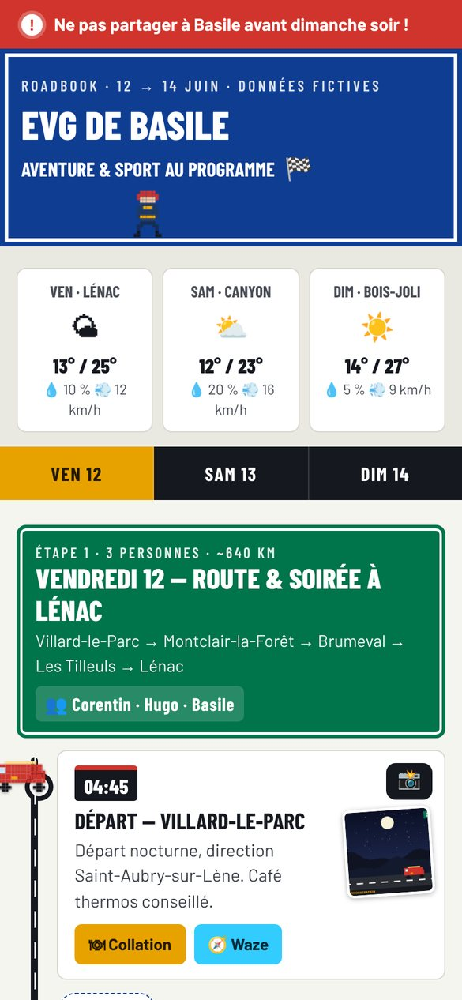
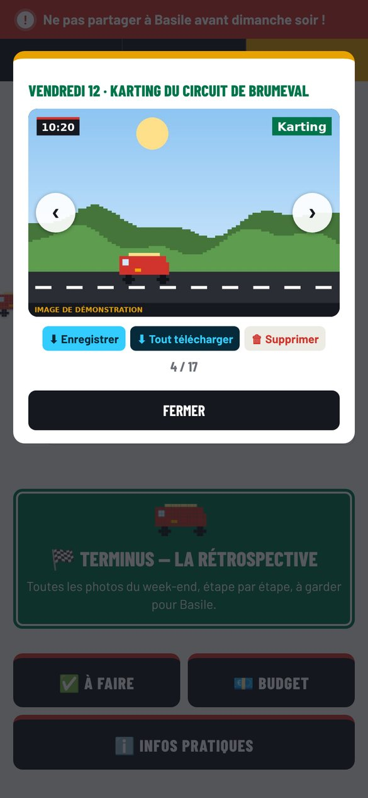
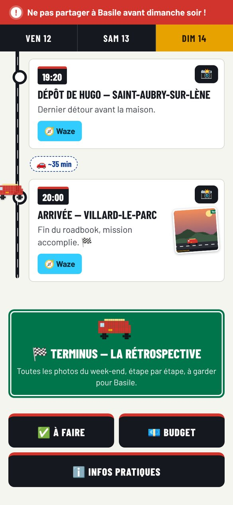

# Étude de cas

Cette page présente le besoin auquel répond le modèle, ses publics, les choix de conception et les pistes d'évolution.

## Le besoin

Un week-end surprise de 3 jours pour 5 personnes cumule beaucoup d'informations : 26 étapes, environ 1 300 km de route, 7 réservations chez des prestataires différents, des participants qui arrivent et repartent à des moments différents, et un budget à répartir alors que tout est offert à l'invité d'honneur.

Ces informations se dispersent vite entre une messagerie de groupe, des courriels de confirmation, une application de cartes et un outil de partage de frais. La question « on part à quelle heure et on va où ? » revient alors sans cesse, et elle retombe toujours sur la même personne.

Le besoin tient en une phrase : un seul lien, lisible sur téléphone, qui dit à chacun où il doit être, quand, avec quoi, et pour combien.

## Le public

La page sert 3 publics, à 3 moments différents.

| Moment | Public | Ce qu'il vient chercher |
|---|---|---|
| Avant | Les organisateurs | Ce qui reste à réserver, ce que coûte le week-end, qui paie quoi |
| Pendant | Les participants, sur la route | L'étape suivante, l'heure, l'itinéraire, le numéro à appeler, ce qu'il faut emporter |
| Après | L'invité d'honneur et ses proches | Les photos du week-end, classées par étape |

Le deuxième moment est le plus contraignant, et c'est pour lui que la page est conçue. Elle est consultée sur un téléphone, d'une main, dans une voiture ou entre deux activités, parfois avec peu de réseau, par des personnes qui n'ont pas suivi la préparation.

## Les choix de conception

**Une page statique, sans installation.** Le site se compose d'une page et d'un fichier de contenu, hébergés gratuitement. Il reste consultable des années plus tard sans maintenance.

**Le contenu séparé du code.** Tout ce qui change d'un week-end à l'autre est regroupé dans `donnees.js`. Une correction d'horaire se fait à un seul endroit, et une personne qui ne programme pas peut adapter le modèle.

**Le téléphone d'abord.** La page est optimisée pour un usage sur smartphone pendant le week-end. La mise en page tient sur un écran étroit, les boutons sont larges, et le bandeau comme la barre des jours restent visibles en permanence. L'onglet du jour en cours passe en jaune.

**La page s'ouvre là où en est le groupe.** Pendant le week-end, le camion suit l'heure du programme : il est sur l'étape à l'heure dite, et entre deux étapes pendant le trajet. La page se place d'elle-même sur l'étape en cours.

**Une lecture en deux niveaux.** La frise n'affiche que l'essentiel : l'heure, le lieu, la durée, les participants du jour et le temps de trajet entre deux étapes. Le détail (adresse, consignes, menu, liste de courses) s'ouvre à la demande dans une fenêtre. En conséquence, le programme d'une journée se parcourt en quelques secondes.

**Des actions plutôt que des informations.** Chaque étape propose le geste utile à ce moment-là : lancer l'itinéraire, appeler le prestataire, ouvrir la fiche du lieu. Une pastille verte indique ce qui est déjà réservé.

**Un langage visuel emprunté à la route.** Les panneaux bleus et verts, la borne rouge et la ligne pointillée reprennent la signalisation routière. Ce code est connu de tous et il hiérarchise l'information sans explication.

**Un budget transparent.** Le coût est détaillé par poste, puis par personne selon les jours de présence. La règle de répartition de la part de l'invité est écrite en toutes lettres, ce qui évite les discussions au moment des comptes.

**Des souvenirs rattachés aux étapes.** Chaque photo se dépose sur l'étape où elle a été prise, depuis l'appareil photo ou la galerie du téléphone. L'album se constitue donc tout seul, dans l'ordre du week-end. Le classement utilise la date de prise de vue et non la date de dépôt, pour que les photos envoyées après coup retrouvent leur place. L'enregistrement d'une photo passe par le partage du téléphone quand il est disponible.

**Aucune donnée envoyée.** Les souvenirs restent dans le navigateur de chacun. Le modèle peut ainsi être essayé et publié sans compte, sans coût et sans risque de dépôt indésirable.

**Une météo qui se lit d'un coup d'œil.** Un pictogramme, 2 températures, la pluie et le vent. Tant que les prévisions ne sont pas disponibles, un soleil animé signale l'emplacement.

**Une page qui change de rôle.** Le bandeau « ne pas partager » disparaît de lui-même après le week-end, la météo passe des prévisions au temps qu'il a réellement fait, et le camion suit de nouveau la lecture. Un réglage masque ensuite tout ce qui relevait de l'organisation. Le carnet de route devient alors un album souvenir à offrir.

**Des options plutôt que des fonctions imposées.** L'étape surprise, les messages vidéo des proches et les codes du stockage partagé sont désactivés par défaut. Le modèle reste simple, et chaque groupe n'active que ce qui lui sert.

**Un thème, pour le ton.** Le modèle est sur le thème des pompiers. Un pompier en pixel art se promène dans l'en-tête et vit de petites saynètes : il mange, retrouve un ami, se fait enlever. Un camion de pompier sert de repère dans la frise. Ce clin d'œil à l'invité d'honneur donne le ton d'un week-end entre amis, et il se remplace par un autre thème en redessinant 2 images.

## Pistes d'évolution

**Des comptes individuels pour le partage.** Le modèle fournit un branchement de stockage partagé, ouvert par défaut, avec des codes en option. Des comptes par participant permettraient de savoir qui a déposé quoi et de confier la modération à une personne.

**Un fonctionnement sans réseau.** La page a besoin d'une connexion à chaque ouverture, alors qu'une partie d'un trajet se fait souvent en zone mal couverte. Une mise en cache du programme réglerait ce point.

**Un budget calculé.** Les montants sont saisis à la main. Un calcul automatique de la part de chacun, à partir des postes et des jours de présence, éviterait les erreurs de report.

**Aucun appel externe.** La police et la bibliothèque de création du zip pourraient être hébergées dans le dépôt, pour une page qui ne contacte aucun service tiers.

**Une accessibilité complète.** Les fenêtres se ferment au clavier, mais elles ne retiennent pas encore le focus. Ce point reste à traiter pour un usage plus large.

## Les écrans

<table>
  <tr>
    <td></td>
    <td></td>
    <td></td>
    <td></td>
  </tr>
  <tr>
    <td align="center">Programme et météo</td>
    <td align="center">Étapes et trajets</td>
    <td align="center">Fiche d'un lieu</td>
    <td align="center">Dépôt d'un souvenir</td>
  </tr>
  <tr>
    <td></td>
    <td></td>
    <td></td>
    <td></td>
  </tr>
  <tr>
    <td align="center">Galerie</td>
    <td align="center">Accès rapide</td>
    <td align="center">Liste « À faire »</td>
    <td align="center">Budget par personne</td>
  </tr>
</table>

Captures réalisées sur un écran de téléphone, avec les données fictives du modèle.

---

[Retour au README](../README.md)
