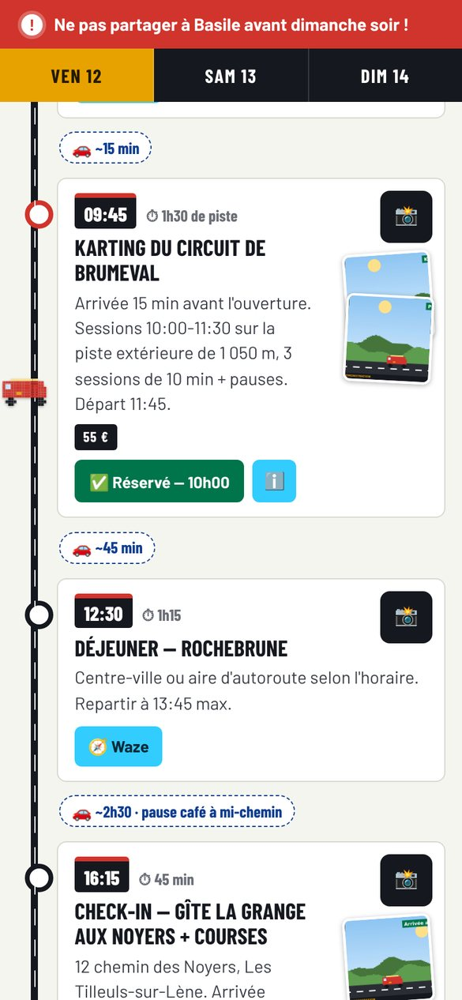
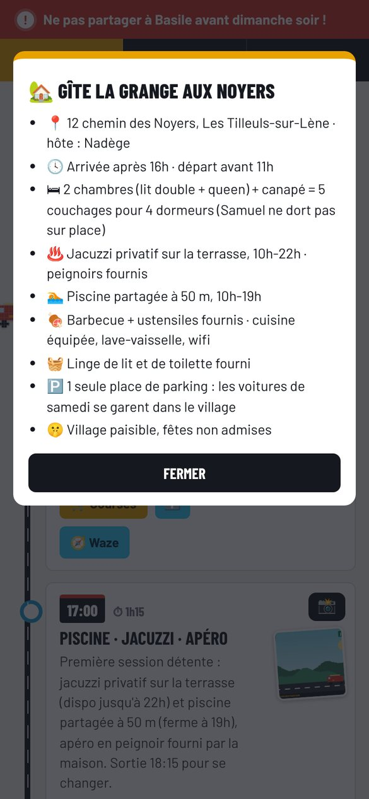
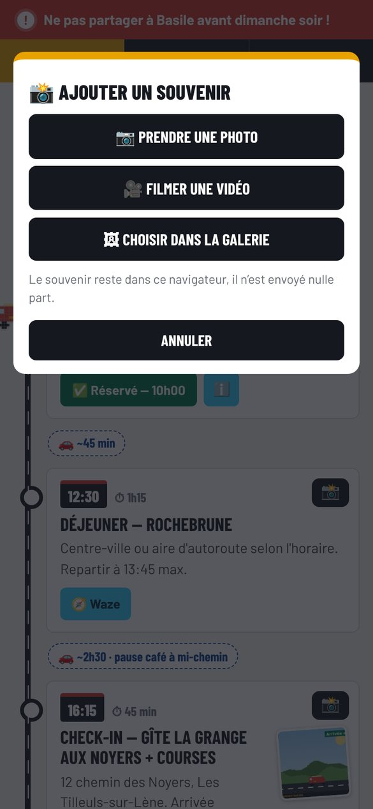
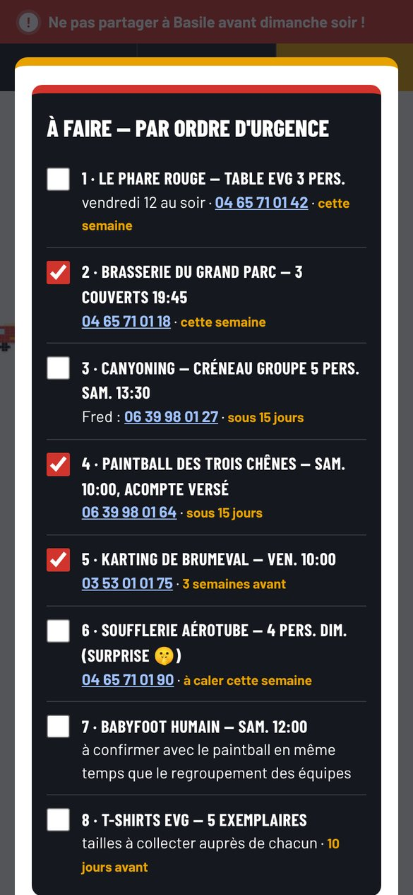
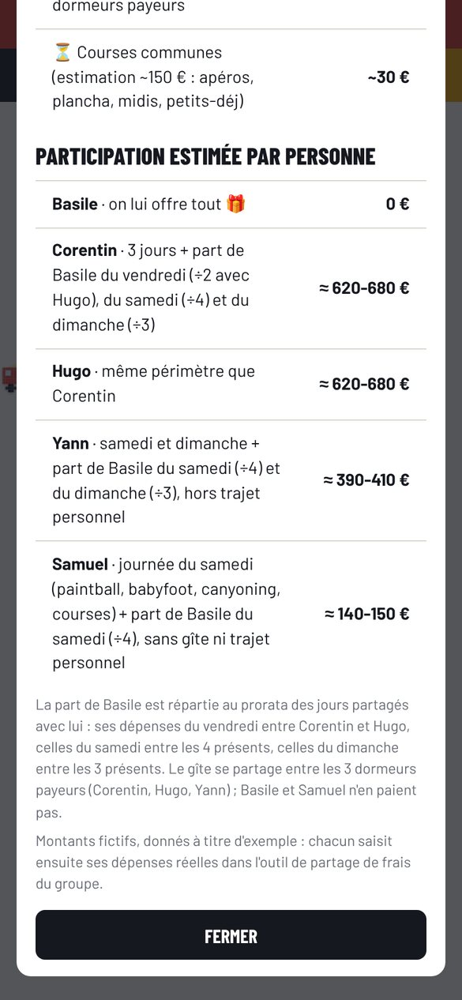

# Étude de cas

Cette page présente le besoin auquel répond le modèle, ses publics, les choix de conception et les pistes d'évolution.

## Le besoin

Un week-end surprise de 3 jours pour 5 personnes cumule beaucoup d'informations : 26 étapes, environ 1 300 km de route, 7 réservations chez des prestataires différents, des participants qui arrivent et repartent à des moments différents, et un budget à répartir alors que tout est offert à l'invité d'honneur.

Ces informations se dispersent vite entre une messagerie de groupe, des courriels de confirmation, une application de cartes et un outil de partage de frais. La question « on part à quelle heure et on va où ? » revient alors sans cesse, et elle retombe toujours sur la même personne.

Le besoin tient en une phrase : un seul lien, lisible sur téléphone, qui dit à chacun où il doit être, quand, avec quoi, et pour combien.

## Le public

La page sert 3 publics, à 3 moments différents.

| Moment | Public | Ce qu'il vient chercher |
|---|---|---|
| Avant | Les organisateurs | Ce qui reste à réserver, ce que coûte le week-end, qui paie quoi |
| Pendant | Les participants, sur la route | L'étape suivante, l'heure, l'itinéraire, le numéro à appeler, ce qu'il faut emporter |
| Après | L'invité d'honneur et ses proches | Les photos du week-end, classées par étape |

Le deuxième moment est le plus contraignant. La page est consultée d'une main, dans une voiture, parfois avec peu de réseau, par des personnes qui n'ont pas suivi la préparation.

## Les choix de conception

**Une page statique, sans installation.** Le site se compose d'une page et d'un fichier de contenu, hébergés gratuitement. Il reste consultable des années plus tard sans maintenance.

**Le contenu séparé du code.** Tout ce qui change d'un week-end à l'autre est regroupé dans `donnees.js`. Une correction d'horaire se fait à un seul endroit, et une personne qui ne programme pas peut adapter le modèle.

**Le téléphone d'abord.** La mise en page est pensée pour un écran étroit. Les boutons sont larges et la barre des jours reste visible en permanence.

**Une lecture en deux niveaux.** La frise n'affiche que l'essentiel : l'heure, le lieu, la durée et le temps de trajet. Le détail (adresse, consignes, menu, liste de courses) s'ouvre à la demande dans une fenêtre. En conséquence, le programme d'une journée se parcourt en quelques secondes.

**Des actions plutôt que des informations.** Chaque étape propose le geste utile à ce moment-là : lancer l'itinéraire, appeler le prestataire, ouvrir la fiche du lieu. Une pastille verte indique ce qui est déjà réservé.

**Un langage visuel emprunté à la route.** Les panneaux bleus et verts, la borne rouge et la ligne pointillée reprennent la signalisation routière. Ce code est connu de tous et il hiérarchise l'information sans explication.

**Un budget transparent.** Le coût est détaillé par poste, puis par personne selon les jours de présence. La règle de répartition de la part de l'invité est écrite en toutes lettres, ce qui évite les discussions au moment des comptes.

**Des souvenirs rattachés aux étapes.** Chaque photo se dépose sur l'étape où elle a été prise. L'album se constitue donc tout seul, dans l'ordre du week-end.

**Aucune donnée envoyée.** Les souvenirs restent dans le navigateur de chacun. Le modèle peut ainsi être essayé et publié sans compte, sans coût et sans risque de dépôt indésirable.

**Une page qui change de rôle.** Le bandeau « ne pas partager » disparaît de lui-même après le week-end, et la météo passe des prévisions aux relevés réels. Le carnet de route devient alors un album souvenir.

**Un peu d'humour.** Le personnage animé de l'en-tête et le camion qui suit la lecture donnent le ton d'un week-end entre amis. Le camion sert aussi de repère de position dans la frise.

## Pistes d'évolution

**Un partage des photos entre participants.** C'est la suite logique du modèle. Elle suppose un service de stockage, un code d'accès pour le groupe et une règle claire sur qui peut supprimer quoi.

**Un fonctionnement sans réseau.** La page a besoin d'une connexion à chaque ouverture, alors qu'une partie d'un trajet se fait souvent en zone mal couverte. Une mise en cache du programme réglerait ce point.

**Un budget calculé.** Les montants sont saisis à la main. Un calcul automatique de la part de chacun, à partir des postes et des jours de présence, éviterait les erreurs de report.

**Aucun appel externe.** La police et la bibliothèque de création du zip pourraient être hébergées dans le dépôt, pour une page qui ne contacte aucun service tiers.

**Une accessibilité complète.** Les fenêtres se ferment au clavier, mais elles ne retiennent pas encore le focus. Ce point reste à traiter pour un usage plus large.

## Les écrans

<table>
  <tr>
    <td></td>
    <td></td>
    <td></td>
    <td></td>
  </tr>
  <tr>
    <td align="center">Programme et météo</td>
    <td align="center">Étapes et trajets</td>
    <td align="center">Fiche d'un lieu</td>
    <td align="center">Dépôt d'un souvenir</td>
  </tr>
  <tr>
    <td></td>
    <td></td>
    <td></td>
    <td></td>
  </tr>
  <tr>
    <td align="center">Galerie</td>
    <td align="center">Accès rapide</td>
    <td align="center">Liste « À faire »</td>
    <td align="center">Budget par personne</td>
  </tr>
</table>

Captures réalisées sur un écran de téléphone, avec les données fictives du modèle.

---

[Retour au README](../README.md)
